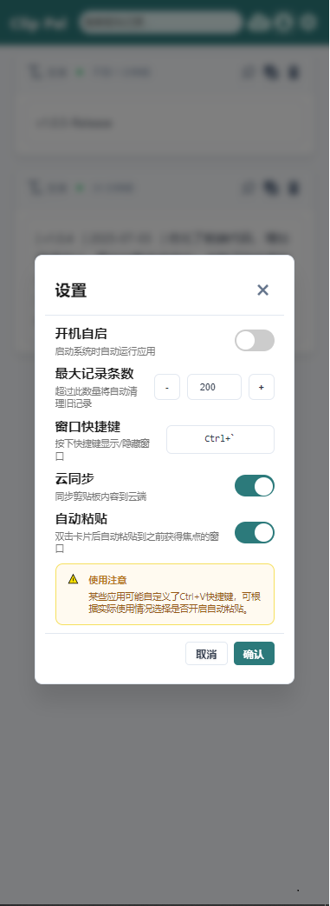

# ClipPal

ClipPal 是基于 Tauri 2 和 Vue 3 的桌面剪贴板管理器。它在本机记录复制过的文本、图片、文件和目录，支持搜索、去重、置顶、删除、快捷键唤起、图片另存为和自动粘贴。文本以加密形式保存在本地 SQLite，图片和文件资源由本机管理。

## 选择版本

| 版本 | 适合谁 | `v2.0.0` 分支当前状态 |
| --- | --- | --- |
| 单机版 | 只在一台电脑使用 | 默认版本，安装后即可使用本地剪贴板历史，无需账号或服务端。 |
| 自建版桌面预览 | 想提前验证自建版本的桌面构建 | 可以打包、安装并使用单机功能。新版同步协议和服务端仍待接入，预览包当前仅提供本地使用。 |

**只想使用 ClipPal**，可在发布页下载与你系统和架构匹配的现成安装包。发布页里的旧版功能以对应版本说明为准。**想自行生成安装包**，请下载 `v2.0.0` 分支源码，从下文第 1 步开始。 [Gitee 发布页](https://gitee.com/ygz123/clip-pal/releases)

## 从零打包桌面端

### 1. 安装构建工具

在目标系统上构建该系统的安装包。首次安装工具后，关闭并重新打开终端，让新命令加入 `PATH`。

1. 安装 Node.js LTS（推荐 22.12+ 或 24 LTS，附带 npm）、Rust（通过 rustup 安装或更新稳定版）和 Git。用 ZIP 下载源码时可跳过 Git。 [Node.js](https://nodejs.org/) · [Rust](https://rustup.rs/) · [Git](https://git-scm.com/downloads)
2. 按平台补装系统工具。

| 系统 | 准备工作 |
| --- | --- |
| macOS | 打开「终端」执行 `xcode-select --install`，按提示安装 Command Line Tools。已安装 Xcode 的机器可用 `xcode-select -p` 检查工具路径。Apple Silicon 推荐使用原生 ARM 终端和 Rust 工具链，`uname -m` 应显示 `arm64`。 |
| Windows 10/11 | 在 Visual Studio Installer 安装 Build Tools 的「使用 C++ 的桌面开发」，包括 MSVC 和 Windows SDK。确认已安装 Microsoft Edge WebView2 Runtime，并使用 MSVC 版 Rust。可运行 `rustc -vV` 检查 `host` 是否以 `windows-msvc` 结尾。建议先从 x64 构建开始。 |

系统依赖安装页面见 [Tauri 环境要求](https://v2.tauri.app/start/prerequisites/)。当前 README 的安装包流程覆盖 macOS 和 Windows，Linux 暂无验收过的发布流程。

macOS 终端可用以下命令检查工具。

```bash
node --version
npm --version
rustc --version
cargo --version
```

Windows PowerShell 把 `npm --version` 换成 `npm.cmd --version`，其余命令相同。项目通过 npm 安装锁定版本的 Tauri 2 CLI，SQLite 由 Rust 依赖提供。

### 2. 下载源码并安装依赖

用 Git 获取源码。以下命令在 macOS 终端和 Windows PowerShell 都可以执行。

```bash
git clone --branch v2.0.0 https://gitee.com/ygz123/clip-pal.git
cd clip-pal
```

也可以在仓库网页切到 `v2.0.0` 后下载 ZIP，解压后进入包含 `Cargo.toml`、`frontend`、`src-tauri` 的目录。接下来的命令都从这个目录执行。

在 macOS 终端运行以下命令。

```bash
npm --prefix frontend ci
```

在 Windows PowerShell 运行以下命令。

```powershell
npm.cmd --prefix frontend ci
```

首次构建还会下载 Rust 依赖和平台打包工具，请保持网络连接。`frontend/package-lock.json` 和 `Cargo.lock` 固定依赖版本，建议保留并使用仓库提供的版本。

### 3. 按需打包

每次选择下面的一条命令。脚本会先编译对应版本的前端，再调用 Tauri 生成安装包。这里生成的是手动更新的个人包。需要搭建自动更新渠道时，按[自动更新配置](#自动更新配置)构建发布包。

| 版本 | macOS 终端 | Windows PowerShell |
| --- | --- | --- |
| 单机版 | `npm --prefix frontend run package:local` | `npm.cmd --prefix frontend run package:local` |
| 自建版桌面预览 | `npm --prefix frontend run package:self-hosted` | `npm.cmd --prefix frontend run package:self-hosted` |

自建预览版当前无需部署地址、令牌或服务器。联网同步开放后，自建配置将包括 HTTPS 服务地址、部署认证和附件限制，届时本节会加入对应的配置与联调步骤。

**需要两个版本时请依次构建。** 两个版本目前沿用 ClipPal 的包标识、产物名称和本地数据目录。每次成功后先把安装包复制到不同目录，例如 `packages/local` 和 `packages/self-hosted`，再构建下一个版本。安装时把它们视为同一个应用的两个构建，切换前先从托盘退出 ClipPal。用来试装的电脑若已有历史数据，建议先退出应用后备份完整 ClipPal 数据目录。

### 4. 找到安装包并试用

终端打印 `Finished ... bundle` 后，会列出本次生成的路径。默认产物位置如下。

| 平台 | 安装文件 | 位置 |
| --- | --- | --- |
| macOS | `.dmg` | `target/release/bundle/dmg/` |
| macOS | `.app` | `target/release/bundle/macos/` |
| Windows | NSIS 安装程序 `.exe` | `target/release/bundle/nsis/` |
| Windows | MSI 安装包 `.msi` | `target/release/bundle/msi/` |

- **macOS** 打开 `.dmg`，把 `ClipPal.app` 拖到「应用程序」。如果 macOS 拦截你亲自构建且确认来源的应用，可在「系统设置 → 隐私与安全性」使用系统提供的「仍要打开」。自动粘贴需要辅助功能授权，在 ClipPal 的「设置 → 自动粘贴」点击「请求授权」或「打开系统设置」。授权后先切回目标应用，再唤起 ClipPal 选择记录。
- **Windows** 双击 `.exe` 或 `.msi`，任选一种即可。安装程序可能需要联网获取 WebView2 Runtime。对于系统安全提示，应先核对安装包来源。
- **验收** 启动后复制一段测试文本和一张图片，打开 ClipPal，检查历史列表、搜索、复制回原应用和图片另存为。退出重开后确认历史仍在。自建预览版按同一组本地功能验收。完整桌面验收见 [单机版验证记录](docs/standalone-validation.md)。

### 可选：用 Cargo 调用 Tauri 打包

`cargo build` 编译 Rust 可执行文件。要生成 `.dmg`、`.msi` 或 NSIS 安装程序，使用 `cargo tauri build`。第 3 步的 npm 脚本把前端构建和 Tauri 打包合在一起，也可以分开执行。首次从源码构建仍需按第 2 步安装 Vue 前端依赖。

首次使用 Cargo 入口时，安装项目已验证的 Tauri CLI 版本。

```sh
cargo install tauri-cli --version 2.9.4 --locked
```

从仓库根目录执行对应版本的两条命令。Windows PowerShell 将 `npm` 改为 `npm.cmd`。如果之前手动设置过 `VITE_EDITION`，先清除该环境变量，让下面的模式选择对应前端。

```sh
# 单机版
npm --prefix frontend run build
cargo tauri build --config src-tauri/tauri.personal.json --features local -- --no-default-features --locked
```

```sh
# 自建桌面预览版
npm --prefix frontend run build -- --mode self-hosted
cargo tauri build --config src-tauri/tauri.personal.json --features self-hosted -- --no-default-features --locked
```

前端构建成功后再执行对应的 Cargo 命令。如果 `dist` 已经由对应版本的前端构建生成，可以直接运行该 Cargo 命令。安装包位置和个人更新配置与第 3 步相同。

### 常见问题

| 现象 | 处理方式 |
| --- | --- |
| 找不到 `node`、`npm` 或 `cargo` | 安装相应工具后重开终端，用第 1 步的版本命令检查。PowerShell 中使用 `npm.cmd`。 |
| `npm ci` 或 Cargo 下载失败 | 先排查网络、代理和对应软件源的连通性。按原命令重试，保留仓库锁文件。 |
| Windows 报 `link.exe` 找不到或缺 Windows SDK | 回到 Visual Studio Installer 补装「使用 C++ 的桌面开发」，确认 `rustc -vV` 的 `host` 是 MSVC，再重开终端。 |
| 只想打某种安装包 | Windows 用 `npm.cmd --prefix frontend run package:local -- --bundles nsis` 单独生成 `.exe`。macOS 用 `npm --prefix frontend run package:local -- --bundles app` 单独生成 `.app`。自建预览使用对应的 `package:self-hosted` 命令。 |
| macOS 报 `failed to run bundle_dmg.sh` | 在真实的 macOS 桌面会话运行打包命令。DMG 制作需要挂载临时磁盘映像。如果只供本机试用，可先用 `-- --bundles app` 生成 `.app` 并复制到「应用程序」。 |
| 生成的文件名仍显示 `1.0.7` | `v2.0.0` 是开发分支名。目前应用打包版本仍为 `1.0.7`，正式发布前会统一版本号。 |
| 找不到安装包或只看到编译产物 | 找终端里第一处 `error`，修复后重新打包。以本次终端列出的 `Finished ... bundle` 路径为准。 |
| 另一个版本好像把原版覆盖了 | 当前两版共用 ClipPal 安装标识，先按第 3 步分目录保存产物。Mac 数据位于 `~/Library/Application Support/ClipPal`，Windows 数据位于 `%APPDATA%\ClipPal`。 |

## 自动更新配置

支持自动更新的安装包会在启动后检查一次版本，也可在「设置 → 检查更新」手动检查。发现新版后，用户确认才会下载，签名通过后才会安装。个人包默认使用 [`src-tauri/tauri.personal.json`](src-tauri/tauri.personal.json)，其中 `endpoints` 为空，`createUpdaterArtifacts` 为 `false`，应用会提示手动安装新版。

搭建自己的更新渠道只需要能提供 HTTPS 静态文件的站点或发布页。客户端内置公钥和更新清单地址，发布者使用对应私钥签名。软件更新和剪贴板云同步各自配置，单机版也能使用自己的更新源。

### 1. 准备 Tauri CLI 和更新密钥

先完成上文的构建环境和依赖安装。以下命令从仓库根目录运行。已安装 Tauri CLI 2.9.4 时可直接使用。

```sh
cargo install tauri-cli --version 2.9.4 --locked
```

**新渠道只生成一次密钥。** 已发布的渠道继续使用与已安装客户端公钥配对的私钥。官方渠道的公钥和清单地址已写在 [`src-tauri/tauri.conf.json`](src-tauri/tauri.conf.json)。

在 macOS 终端生成密钥。

```sh
mkdir -p "$HOME/.tauri"
cargo tauri signer generate -w "$HOME/.tauri/clippal-update.key"
```

在 Windows PowerShell 生成密钥。

```powershell
New-Item -ItemType Directory -Force "$HOME/.tauri" | Out-Null
cargo tauri signer generate -w "$HOME/.tauri/clippal-update.key"
```

- `clippal-update.key.pub` 是公钥文件，复制其完整文本到客户端配置的 `pubkey`。
- `clippal-update.key` 是私钥文件，和生成时设置的密码一起保存在安全位置。两者只用于构建或 CI，避免提交到仓库。
- 私钥遗失或更换后，已安装客户端仍只信任原公钥。若无法继续使用原私钥，用户需手动安装内置新公钥的版本，才能接收新渠道的更新。

Tauri 更新签名用于验证下载的更新包。公开分发时，按平台另行配置 macOS Developer ID 签名与公证、Windows Authenticode 签名。 [Tauri 更新文档](https://v2.tauri.app/plugin/updater/) · [Tauri 分发文档](https://v2.tauri.app/distribute/)

### 2. 配置更新清单地址和公钥

自建渠道在 `src-tauri` 下创建 `tauri.release.json`，用 `.pub` 文件内容和自己的 HTTPS 地址替换示例占位值。地址要指向客户端下载时能直接读取的 `latest.json`。从第一版开始就用同一个渠道地址构建安装包，后续发布时更新该地址上的文件内容。

```json
{
  "bundle": {
    "createUpdaterArtifacts": true
  },
  "plugins": {
    "updater": {
      "pubkey": "替换为 clippal-update.key.pub 的完整文本",
      "endpoints": ["https://updates.example.com/clippal/local/latest.json"]
    }
  }
}
```

`createUpdaterArtifacts` 决定打包时是否生成更新产物，`endpoints` 决定客户端去哪里查版本。单机、自建和商业构建使用各自的更新清单地址，只在该地址发布对应类型的包，避免升级时切换版本类型。自建预览版仍只提供本地剪贴板功能。

### 3. 提高版本号并构建签名产物

将 `src-tauri/tauri.conf.json` 中的 `version` 提高到比已安装版本更新的语义版本，例如从 `1.0.7` 提高到 `2.0.0`。同步 `Cargo.toml` 的 workspace 应用版本和 `frontend/package.json` 的版本，并更新锁文件。`latest.json` 要填写最终安装包中的版本号，Git 分支名或标签不影响检查结果。

修改版本号后，从仓库根目录执行 `cargo update --workspace` 和 `npm --prefix frontend install --package-lock-only`。Windows PowerShell 使用 `npm.cmd`。

以下命令构建启用自有更新源的单机发布包。官方发布沿用仓库中的更新源和公钥时，去掉 `--config src-tauri/tauri.release.json`，并使用官方渠道对应的私钥。个人打包命令默认使用手动更新配置。

macOS 默认终端使用 zsh，可以直接运行以下命令。

```zsh
export TAURI_SIGNING_PRIVATE_KEY="$HOME/.tauri/clippal-update.key"
read -rs 'TAURI_SIGNING_PRIVATE_KEY_PASSWORD?请输入更新私钥密码：'
echo
export TAURI_SIGNING_PRIVATE_KEY_PASSWORD
VITE_EDITION=local npm --prefix frontend run build && \
  cargo tauri build --config src-tauri/tauri.release.json --features local -- --no-default-features --locked
unset TAURI_SIGNING_PRIVATE_KEY TAURI_SIGNING_PRIVATE_KEY_PASSWORD
```

在 Windows PowerShell 运行以下命令。

```powershell
$env:TAURI_SIGNING_PRIVATE_KEY = "$HOME/.tauri/clippal-update.key"
$clippalSigningPassword = Read-Host "请输入更新私钥密码" -AsSecureString
$env:TAURI_SIGNING_PRIVATE_KEY_PASSWORD = [System.Net.NetworkCredential]::new("", $clippalSigningPassword).Password
$env:VITE_EDITION = "local"
try {
    npm.cmd --prefix frontend run build
    if ($LASTEXITCODE -ne 0) { throw "前端构建失败" }
    cargo tauri build --config src-tauri/tauri.release.json --features local -- --no-default-features --locked
    if ($LASTEXITCODE -ne 0) { throw "安装包构建失败" }
} finally {
    Remove-Item Env:TAURI_SIGNING_PRIVATE_KEY, Env:TAURI_SIGNING_PRIVATE_KEY_PASSWORD, Env:VITE_EDITION
    $clippalSigningPassword.Dispose()
}
```

自建桌面预览若要连自己的更新源，先将配置中的地址改成自建渠道，例如 `https://updates.example.com/clippal/self-hosted/latest.json`。将构建命令中的 `VITE_EDITION=local`（PowerShell 为 `"local"`）和 `--features local` 改成对应的 `self-hosted`，并保留 `--no-default-features`。每个渠道分别归档产物。

### 4. 上传产物，再发布 `latest.json`

按目标系统和架构构建，使用打包命令实际输出的文件名。安装包供首次安装使用，签名更新包供应用内更新使用。

| 平台 | `platforms` 键 | `url` 指向的更新文件 |
| --- | --- | --- |
| Apple Silicon Mac | `darwin-aarch64` | `bundle/macos/` 下的 `.app.tar.gz`，其 `.sig` 在同一目录 |
| Intel Mac | `darwin-x86_64` | Intel 构建生成的 `.app.tar.gz` 和对应 `.sig` |
| Windows x64 | `windows-x86_64` | `bundle/nsis/` 的 `.exe` 或 `bundle/msi/` 的 `.msi`，使用所选文件对应的 `.sig` |

以下示例只发布 Apple Silicon Mac。将 `url` 换成上传后的更新包直链，将 `signature` 换成对应 `.sig` 文件的完整文本。其他平台按同样方式添加，填入该平台实际发布的文件和签名。

```json
{
  "version": "2.0.0",
  "notes": "修复开机自启时弹出主窗口的问题。",
  "pub_date": "2026-11-22T10:00:00+08:00",
  "platforms": {
    "darwin-aarch64": {
      "url": "https://updates.example.com/clippal/local/2.0.0/ClipPal.app.tar.gz",
      "signature": "替换为该更新包的 .sig 文件内容"
    }
  }
}
```

`pub_date` 使用 RFC 3339 时间格式。macOS 手动安装继续提供 `.dmg`，更新清单引用 `.app.tar.gz`。每个 `signature` 与 `url` 对应到同一份构建产物，签名后保持文件内容原样。仓库根目录的 [`latest.json`](latest.json) 可作为现有渠道格式参考，客户端读取的是 `endpoints` 中的线上地址。

先上传带版本号的安装和更新产物，验证 HTTPS 直链能下载，再把清单发布到 `endpoints` 指向的固定位置。正式发布前，在测试渠道用前一版安装包走一遍「检查更新 → 确认 → 下载和验签 → 安装 → 重启」，核对版本号及原有剪贴板历史。官方发布继续保留上一版产物和清单，便于定位发布问题。

| 更新界面现象 | 检查位置 |
| --- | --- |
| 提示手动更新 | 确认已安装的是启用更新源的发布包。macOS 应从安装后的 `.app` 运行。 |
| 已是最新版本 | 检查线上清单 `version` 是否比已安装版本更新，确认地址上的文件已经刷新。 |
| 暂无适用安装包 | 检查 `platforms` 是否包含当前系统和运行架构。 |
| 签名校验失败 | 检查客户端公钥是否与构建私钥配对，确认 `.sig` 和实际下载的文件相对应。 |

## 界面与项目结构




商业扩展示例见 [用户信息](assets/3.png) 和 [VIP](assets/4.png)。代码依赖方向为 **商业版 → 自建版 → 单机版核心**。本仓库的 `src-tauri` 提供打包入口，`desktop-tauri` 负责桌面适配，`desktop-app-core` 和 `clip-core` 提供本地业务，`frontend` 提供 Vue 页面。自建同步、独立商业仓库和可选 AI 能力的设计见 [v2.0.0 架构规划](docs/2.0.0-architecture.md)，本地库和删除策略见 [单机数据库 v2](docs/local-database-v2.md)。主要依赖包括 [Tauri](https://tauri.app/)、[RBatis](https://github.com/rbatis/rbatis)、[Serde](https://serde.rs/) 和 [clipboard-rs](https://github.com/ChurchTao/clipboard-rs)。

## 版本记录

| 版本号   | 日期         | 主要更新内容                                                                                             |
|----------|--------------|----------------------------------------------------------------------------------------------------|
| v1.0.0   | 2025-06-18   | 项目初始化，支持基础剪贴板监听与历史管理                                                                               |
| v1.0.1   | 2025-06-19   | 增加图片另存为功能，禁用页面鼠标右键，优化部分样式                                                                          |
| v1.0.2   | 2025-06-26   | 优化sqlite初始化逻辑，支持字段新增；添加数据加密存储功能(数据加密使用了分词功能，导致安装包体积增大了很多TvT)；增强日志打印；优化错误处理等等<br/>⚠️ 本次更新后需卸载并清除旧数据 |
| v1.0.3   | 2025-06-28   | 新增了自动粘贴功能；新增了新手引导；优化前端对内容卡片的展示样式；优化了部分代码                                                           |
| v1.0.4   | 2025-07-03   | 优化了前端代码，增加自适应UI，图片加载方式优化；去除了对内容的分词处理(安装包体积大大降低、内存占用率也大大降低)和.bin文件存储，采用内存搜索和bloomfilter配合的方式处理模糊搜索  |
| v1.0.5   | 2025-09-04   | 处理了很多bug；添加了云同步功能；添加了用户登录相关功能；添加了vip和支付相关功能  |
| v1.0.6   | 2025-10-31   | 添加软件更新功能  |
| v1.0.7   | 2025-11-27   | 适配macOS,处理部分bug  |

## 开源协议

本项目基于 [Apache License 2.0](LICENSE) 开源。你可以自由使用、修改和分发本项目，但请保留原作者版权声明。

## ⚖️ 免责声明

1. 本项目是作为一款开源项目提供的，开发者在法律允许的范围内不对软件的功能性、安全性或适用性提供任何形式的明示或暗示的保证。
2. 用户明确理解并同意，使用本软件的风险完全由用户自己承担，软件以"现状"和"现有"基础提供。开发者不提供任何形式的担保，无论是明示还是暗示的，包括但不限于适销性、特定用途的适用性和非侵权的担保。
3. 在任何情况下，开发者或其供应商都不对任何直接的、间接的、偶然的、特殊的、惩罚性的或后果性的损害承担责任，包括但不限于使用本软件产生的利润损失、业务中断、个人信息泄露或其他商业损害或损失。
4. 所有在本项目上进行二次开发的用户，都需承诺将本软件用于合法目的，并自行负责遵守当地的法律和法规。
5. 开发者有权在任何时间修改软件的功能或特性，以及本免责声明的任何部分，并且这些修改可能会以软件更新的形式体现。

**本免责声明的最终解释权归开发者所有**

## 贡献方式

欢迎任何形式的贡献！你可以通过以下方式参与：
- 提交 Issue 反馈 bug 或建议
- Fork 并提交 Pull Request

## 联系方式

- 作者：jingchuan
- 邮箱：1750777402@qq.com
- QQ: 1750777402
- GitHub: https://github.com/1750777402/ClipPal
- Gitee: https://gitee.com/ygz123/clip-pal

---

> 本项目致力于为用户提供高效、安全的剪贴板管理体验。如果你喜欢本项目，欢迎 star、推荐和分享！
