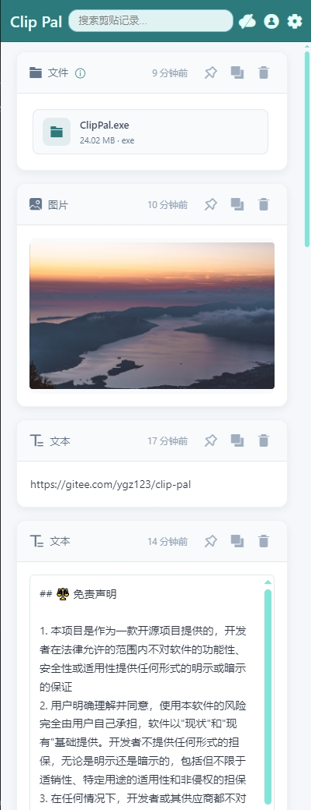

# ClipPal

ClipPal 是基于 Tauri 2 和 Vue 3 的桌面剪贴板管理器。它在本机记录复制过的文本、图片、文件和目录，支持搜索、去重、置顶、删除、快捷键唤起、图片另存为和自动粘贴。文本以加密形式保存在本地 SQLite，图片和文件资源由本机管理。

## 选择版本

| 版本 | 适合谁 | `v2.0.0` 分支当前状态 |
| --- | --- | --- |
| 单机版 | 只在一台电脑使用 | 默认版本，安装后即可使用本地剪贴板历史，无需账号或服务端。 |
| 自建版 | 想连接自己的同步服务 | 提供单机功能和文本云同步。 |

**只想使用 ClipPal**，可在发布页下载与你系统和架构匹配的现成安装包。发布页里的旧版功能以对应版本说明为准。**想自行生成安装包**，请下载 `v2.0.0` 分支源码，从下文第 1 步开始。 [Gitee 发布页](https://gitee.com/ygz123/clip-pal/releases)

## 日常开发

先按下文准备工具和前端依赖。除 Java 启动步骤外，以下命令都在 VS Code 的 ClipPal 仓库根目录执行。 [安装工具](#1-安装构建工具) · [安装依赖](#2-下载源码并安装依赖)

### 常用命令

macOS 和 Windows 使用相同的 Cargo 命令。

| 版本 | 启动开发 | 打包安装包 |
| --- | --- | --- |
| 单机版 | `cargo dev-local` | `cargo build-local` |
| 自建版（云同步） | `cargo dev-sync` | `cargo build-sync` |

### 启动自建版并联调云同步

1. 启动本机 MySQL 8。如果使用现有的 Docker 容器，运行 `docker start mysql84`。第一次使用开发库时，选中专用的 `clip_pal_sync` 库，执行服务端的 `sql/init.sql`。
2. 用 IDEA 打开同级的 `clip-pal-sync` 工程，选择 JDK 21，运行 `ClipPal Sync Local`。它读取服务端的 `config/application-local.yml`。访问 `http://127.0.0.1:8080/actuator/health`，确认返回 `UP`。
3. 首次配置时，在客户端的 `src-tauri/config.json` 中将 `cloud_sync.enabled` 设为 `true`，将 `cloud_sync.domain` 设为 `http://127.0.0.1:8080`。客户端部署令牌与服务端保持一致，客户端密钥解混淆后应与服务端 `clip-pal.sync.content-key` 一致。保留已有的 `app_secret`。 [配置字段与 IDEA 启动参数](docs/local-sync-development.md)
4. 如果有旧的开发进程，先按 `Ctrl+C` 停止，并从托盘退出旧 ClipPal。在 VS Code 终端运行 `cargo dev-sync`。

两个版本都使用和安装版相同的 ClipPal 数据目录。macOS 默认是 `~/Library/Application Support/ClipPal`，Windows 默认是 `%LOCALAPPDATA%\ClipPal\data`。平时切换版本只需换命令。自建版首次绑定时，会将符合条件的已有文本纳入同步。

启动后从「设置 → 文本云同步」确认部署已连接，再复制一条新文本。本地列表应显示这条记录。开发库的 `clip_record` 应写入对应内容，`clip_sync_change` 应新增 `upsert` 动作。也可以停掉 Java 后再复制一条文本，重启服务并检查补传。 [手动验收与查库 SQL](docs/local-sync-development.md#4-手动验证)

### 常用检查

| 用途 | 从客户端仓库根目录执行 |
| --- | --- |
| 检查 Rust workspace | `cargo check --workspace --locked` |
| 检查自建版 Rust 编译 | `cargo check -p ClipPal --no-default-features --features self-hosted --locked` |
| 检查 Vue 类型并构建前端 | `npm --prefix frontend run build`，Windows PowerShell 用 `npm.cmd` |
| 检查 v2 模块边界 | `python3 scripts/check-v2-structure.py` |
| 用系统剪贴板验证自建同步 | 启动日常 Java 服务和 `cargo dev-sync` 后，运行 `python3 scripts/test-cloud-sync.py` |

## 从零打包桌面端

### 1. 安装构建工具

在目标系统上构建该系统的安装包。首次安装工具后，关闭并重新打开终端，让新命令加入 `PATH`。

1. 安装 Node.js LTS（推荐 22.12+ 或 24 LTS，附带 npm）、Rust（通过 rustup 安装或更新稳定版）和 Git。用 ZIP 下载源码时可跳过 Git。 [Node.js](https://nodejs.org/) · [Rust](https://rustup.rs/) · [Git](https://git-scm.com/downloads)
2. 按平台补装系统工具。

| 系统 | 准备工作 |
| --- | --- |
| macOS | 打开「终端」执行 `xcode-select --install`，按提示安装 Command Line Tools。已安装 Xcode 的机器可用 `xcode-select -p` 检查工具路径。Apple Silicon 推荐使用原生 ARM 终端和 Rust 工具链，`uname -m` 应显示 `arm64`。 |
| Windows 10/11 | 在 Visual Studio Installer 安装 Build Tools 的「使用 C++ 的桌面开发」，包括 MSVC 和 Windows SDK。确认已安装 Microsoft Edge WebView2 Runtime，并使用 MSVC 版 Rust。可运行 `rustc -vV` 检查 `host` 是否以 `windows-msvc` 结尾。建议先从 x64 构建开始。 |

系统依赖安装页面见 [Tauri 环境要求](https://v2.tauri.app/start/prerequisites/)。当前 README 的安装包流程覆盖 macOS 和 Windows，Linux 暂无验收过的发布流程。

macOS 终端可用以下命令检查工具。

```bash
node --version
npm --version
rustc --version
cargo --version
```

Windows PowerShell 把 `npm --version` 换成 `npm.cmd --version`，其余命令相同。首次使用 Cargo 打包时，安装已验证的 Tauri CLI 版本。已有该版本时可跳过安装。

```sh
cargo install tauri-cli --version 2.9.4 --locked
cargo tauri --version
```

### 2. 下载源码并安装依赖

用 Git 获取源码。以下命令在 macOS 终端和 Windows PowerShell 都可以执行。

```bash
git clone --branch v2.0.0 https://gitee.com/ygz123/clip-pal.git
cd clip-pal
```

也可以在仓库网页切到 `v2.0.0` 后下载 ZIP，解压后进入包含 `Cargo.toml`、`frontend`、`src-tauri` 的目录。接下来的命令都从这个目录执行。

在 macOS 终端运行以下命令。

```bash
npm --prefix frontend ci
```

在 Windows PowerShell 运行以下命令。

```powershell
npm.cmd --prefix frontend ci
```

首次构建还会下载 Rust 依赖和平台打包工具，请保持网络连接。`frontend/package-lock.json` 和 `Cargo.lock` 固定依赖版本，建议保留并使用仓库提供的版本。

### 3. 按需打包

在仓库根目录执行对应版本的命令，macOS 终端和 Windows PowerShell 用法相同。Tauri 会自动编译对应版本的 Vue 前端、编译 Rust 并生成安装包。npm 负责安装前端依赖以及执行 Tauri 的前端构建钩子。这里生成的是手动更新的个人包。带自动更新的发布包请参照[自动更新配置](docs/auto-update.md)。

```sh
# 单机版
cargo build-local

# 自建版
cargo build-sync
```

这两条命令封装了 `cargo tauri build` 的版本和个人包配置。想手动指定安装包格式时，可用下方常见问题里的完整命令。

自建版已接入文本云同步，需要配置服务地址、部署令牌并启用 `cloud_sync.enabled`。单机开发命令 `cargo tauri dev` 默认不会启动同步。本机连接普通 Spring Boot HTTP 的步骤见[本地同步联调](docs/local-sync-development.md)。正式安装包仍要求 HTTPS，由 Nginx 转发到 HTTP 服务端。

**需要两个版本时请依次构建。** 两个版本目前沿用 ClipPal 的包标识、产物名称和本地数据目录。每次成功后先把安装包复制到不同目录，例如 `packages/local` 和 `packages/self-hosted`，再构建下一个版本。安装时把它们视为同一个应用的两个构建，切换前先从托盘退出 ClipPal。用来试装的电脑若已有历史数据，建议先退出应用后备份完整 ClipPal 数据目录。

### 4. 找到安装包并试用

终端打印 `Finished ... bundle` 后，会列出本次生成的路径。默认产物位置如下。

| 平台 | 安装文件 | 位置 |
| --- | --- | --- |
| macOS | `.dmg` | `target/release/bundle/dmg/` |
| macOS | `.app` | `target/release/bundle/macos/` |
| Windows | NSIS 安装程序 `.exe` | `target/release/bundle/nsis/` |
| Windows | MSI 安装包 `.msi` | `target/release/bundle/msi/` |

- **macOS** 打开 `.dmg`，把 `ClipPal.app` 拖到「应用程序」。如果 macOS 拦截你亲自构建且确认来源的应用，可在「系统设置 → 隐私与安全性」使用系统提供的「仍要打开」。自动粘贴需要辅助功能授权，在 ClipPal 的「设置 → 自动粘贴」点击「请求授权」或「打开系统设置」。授权后先切回目标应用，再唤起 ClipPal 选择记录。
- **Windows** 双击 `.exe` 或 `.msi`，任选一种即可。安装程序可能需要联网获取 WebView2 Runtime。对于系统安全提示，应先核对安装包来源。
- **验收** 启动后复制一段测试文本和一张图片，打开 ClipPal，检查历史列表、搜索、复制回原应用和图片另存为。退出重开后确认历史仍在。自建版还可以按联调文档检查文本上传。完整桌面验收见 [单机版验证记录](docs/standalone-validation.md)。

### 常见问题

| 现象 | 处理方式 |
| --- | --- |
| 找不到 `node`、`npm` 或 `cargo` | 安装相应工具后重开终端，用第 1 步的版本命令检查。PowerShell 中使用 `npm.cmd`。 |
| `npm ci` 或 Cargo 下载失败 | 先排查网络、代理和对应软件源的连通性。按原命令重试，保留仓库锁文件。 |
| Windows 报 `link.exe` 找不到或缺 Windows SDK | 回到 Visual Studio Installer 补装「使用 C++ 的桌面开发」，确认 `rustc -vV` 的 `host` 是 MSVC，再重开终端。 |
| 只想打某种安装包 | 单机版示例 `cargo tauri build --bundles app --config src-tauri/tauri.personal.json -- --locked`。Windows 将 `app` 换成 `nsis`。自建版再加上 `--config src-tauri/tauri.self-hosted.json`，并在末尾的 `--locked` 前加上 `--no-default-features`。 |
| macOS 报 `failed to run bundle_dmg.sh` | 在真实的 macOS 桌面会话运行打包命令。DMG 制作需要挂载临时磁盘映像。本机试用可用 `--bundles app` 生成 `.app` 并复制到「应用程序」。 |
| 生成的文件名仍显示 `1.0.7` | `v2.0.0` 是开发分支名。目前应用打包版本仍为 `1.0.7`，正式发布前会统一版本号。 |
| 找不到安装包或只看到编译产物 | 找终端里第一处 `error`，修复后重新打包。以本次终端列出的 `Finished ... bundle` 路径为准。 |
| 另一个版本好像把原版覆盖了 | 当前两版共用 ClipPal 安装标识，先按第 3 步分目录保存产物。Mac 数据位于 `~/Library/Application Support/ClipPal`，Windows 数据位于 `%LOCALAPPDATA%\ClipPal\data`。 |

## 界面与项目结构




商业扩展示例见 [用户信息](assets/3.png) 和 [VIP](assets/4.png)。代码依赖方向为 **商业版 → 自建版 → 单机版核心**。本仓库的 `src-tauri` 提供打包入口，`desktop-tauri` 负责桌面适配，`desktop-app-core` 和 `clip-core` 提供本地业务，`frontend` 提供 Vue 页面。自建同步、独立商业仓库和可选 AI 能力的设计见 [v2.0.0 架构规划](docs/2.0.0-architecture.md)，本地库和删除策略见 [单机数据库 v2](docs/local-database-v2.md)。主要依赖包括 [Tauri](https://tauri.app/)、[RBatis](https://github.com/rbatis/rbatis)、[Serde](https://serde.rs/) 和 [clipboard-rs](https://github.com/ChurchTao/clipboard-rs)。

## 版本记录

| 版本号   | 日期         | 主要更新内容                                                                                             |
|----------|--------------|----------------------------------------------------------------------------------------------------|
| v1.0.0   | 2025-06-18   | 项目初始化，支持基础剪贴板监听与历史管理                                                                               |
| v1.0.1   | 2025-06-19   | 增加图片另存为功能，禁用页面鼠标右键，优化部分样式                                                                          |
| v1.0.2   | 2025-06-26   | 优化sqlite初始化逻辑，支持字段新增；添加数据加密存储功能(数据加密使用了分词功能，导致安装包体积增大了很多TvT)；增强日志打印；优化错误处理等等<br/>⚠️ 本次更新后需卸载并清除旧数据 |
| v1.0.3   | 2025-06-28   | 新增了自动粘贴功能；新增了新手引导；优化前端对内容卡片的展示样式；优化了部分代码                                                           |
| v1.0.4   | 2025-07-03   | 优化了前端代码，增加自适应UI，图片加载方式优化；去除了对内容的分词处理(安装包体积大大降低、内存占用率也大大降低)和.bin文件存储，采用内存搜索和bloomfilter配合的方式处理模糊搜索  |
| v1.0.5   | 2025-09-04   | 处理了很多bug；添加了云同步功能；添加了用户登录相关功能；添加了vip和支付相关功能  |
| v1.0.6   | 2025-10-31   | 添加软件更新功能  |
| v1.0.7   | 2025-11-27   | 适配macOS,处理部分bug  |

## 开源协议

本项目基于 [Apache License 2.0](LICENSE) 开源。你可以自由使用、修改和分发本项目，但请保留原作者版权声明。

## ⚖️ 免责声明

1. 本项目是作为一款开源项目提供的，开发者在法律允许的范围内不对软件的功能性、安全性或适用性提供任何形式的明示或暗示的保证。
2. 用户明确理解并同意，使用本软件的风险完全由用户自己承担，软件以"现状"和"现有"基础提供。开发者不提供任何形式的担保，无论是明示还是暗示的，包括但不限于适销性、特定用途的适用性和非侵权的担保。
3. 在任何情况下，开发者或其供应商都不对任何直接的、间接的、偶然的、特殊的、惩罚性的或后果性的损害承担责任，包括但不限于使用本软件产生的利润损失、业务中断、个人信息泄露或其他商业损害或损失。
4. 所有在本项目上进行二次开发的用户，都需承诺将本软件用于合法目的，并自行负责遵守当地的法律和法规。
5. 开发者有权在任何时间修改软件的功能或特性，以及本免责声明的任何部分，并且这些修改可能会以软件更新的形式体现。

**本免责声明的最终解释权归开发者所有**

## 贡献方式

欢迎任何形式的贡献！你可以通过以下方式参与：
- 提交 Issue 反馈 bug 或建议
- Fork 并提交 Pull Request

## 联系方式

- 作者：jingchuan
- 邮箱：1750777402@qq.com
- QQ: 1750777402
- GitHub: https://github.com/1750777402/ClipPal
- Gitee: https://gitee.com/ygz123/clip-pal

---

> 本项目致力于为用户提供高效、安全的剪贴板管理体验。如果你喜欢本项目，欢迎 star、推荐和分享！
